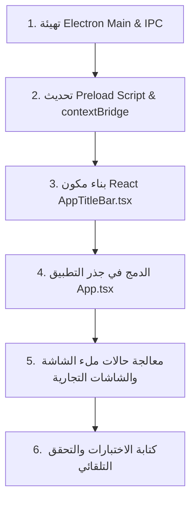

# 📋 خطة التطوير والتنفيذ الهندسية: شريط عنوان نافذة التطبيق المدمج (Electron Custom Titlebar)
> **المشروع**: AN POS | **المكون المستهدف**: شريط النافذة الخارجي + تكامل Electron Main/Preload/Renderer  
> **المرجع التصميمي**: `.opencode/skills/ui-ux-pro-max/SKILL.md` | معايير `ISO 9241-410` | إرشادات أنظمة سطح المكتب لـ Electron & Windows/Linux  
> **تاريخ الإعداد**: أكتوبر 2026 | **الحالة**: ✅ مكتملة ومنفذة بنسبة 100% ومختبرة آلياً  

---

## 📌 الفهرس التنفيذي

1. [الأهداف الهندسية والتشغيلية](#1-الأهداف-الهندسية-والتشغيلية)
2. [تحليل المشكلة الحالية (Root Cause Analysis)](#2-تحليل-المشكلة-الحالية-root-cause-analysis)
3. [المكونات المستهدفة ونطاق التعديل البرمجي](#3-المكونات-المستهدفة-ونطاق-التعديل-البرمجي)
4. [المواصفات التصميمية والتقنية (UI/UX Pro Max)](#4-المواصفات-التصميمية-والتقنية-uiux-pro-max)
   * [4.1 الهوية البصرية والأيقونة الرسمية](#41-الهوية-البصرية-والأيقونة-الرسمية)
   * [4.2 لوحة الألوان والتوافق مع الوضعين (Dark / Light)](#42-لوحة-الألوان-والتوافق-مع-الوضعين-dark--light)
   * [4.3 أزرار التحكم وحالات التفاعل (Hover & Active States)](#43-أزرار-التحكم-وحالات-التفاعل-hover--active-states)
   * [4.4 فيزياء السحب والتكبير بالنقر المزدوج (Window Drag & Double-Click)](#44-فيزياء-السحب-والتكبير-بالنقر-المزدوج-window-drag--double-click)
5. [مصفوفة قنوات الاتصال البرمجية (IPC Channels Matrix)](#5-مصفوفة-قنوات-الاتصال-البرمجية-ipc-channels-matrix)
6. [مراحل التنفيذ خطوة بخطوة (Implementation Roadmap)](#6-مراحل-التنفيذ-خطوة-بخطوة-implementation-roadmap)
7. [معايير القبول وضمان الجودة (Definition of Done & Testing Plan)](#7-معايير-القبول-وضمان-الجودة-definition-of-done--testing-plan)

---

## 1. الأهداف الهندسية والتشغيلية

تهدف هذه الخطة إلى استبدال شريط النافذة الافتراضي لنظام التشغيل بشريط عنوان مدمج وحديث كلياً (**Custom Frameless Titlebar**) يتوافق بنسبة **100%** مع نظام تصميم **AN POS**، محققاً الأهداف التالية:
* **التوافق اللوني التام (Seamless Theme Integration)**: القضاء على التنافر البصري بين أشرطة نظام التشغيل الرمادية/البيضاء الافتراضية وثيم التطبيق، ومطابقة درجات ألوان الوضع الليلي (`#0f172a` / `#0b0e15`) والوضع النهاري (`#f8fafc` / `#ffffff`).
* **إبراز أيقونة وهوية التطبيق**: إدراج أيقونة **AN POS** الرسمية المعتمدة (`an-pos-icon.png`) بجودة متجهة عالية إلى جانب اسم البرنامج وإصدار النظام.
* **التحكم الاحترافي الكامل بالنوافذ**: توفير أزرار تحكم سلسة (تصغير، تكبير/استعادة، إغلاق) تدعم تأثيرات التمرير الدقيقة (مثل الإغلاق الأحمر التحذيري `#dc2626`).
* **دعم السحب والنقر المزدوج**: دعم سحب النافذة بسلاسة عبر معيار `-webkit-app-region: drag` والنقر المزدوج للتكبير/الاستعادة مع استثناء أزرار التفاعل من السحب (`no-drag`).
* **الحساسية لوضع ملء الشاشة (Fullscreen Kiosk Awareness)**: الإخفاء التلقائي السلس لشريط العنوان عند دخول نقطة البيع في وضع الشاشة الكاملة (`F11`) لتوفير 100% من المساحة للكاشير.

---

## 2. تحليل المشكلة الحالية (Root Cause Analysis)

1. **الاعتماد على إطار النافذة الافتراضي**:
   - في [`electron/main/index.ts`](file:///home/ammar/AN-POS-TEST/electron/main/index.ts)، يتم إنشاء `BrowserWindow` بدون ضبط خاصية الإطار المخصص (`frame: false` أو `titleBarStyle: 'hidden'`).
   - هذا يجعل نظام التشغيل (خصوصاً بيئات لينكس مثل GNOME/KDE و ويندوز) يرسم شريط العنوان الافتراضي الخاص بمدير النوافذ الخارجي.
2. **غياب أيقونة التطبيق في شريط النافذة**:
   - على بيئات لينكس (Wayland / X11)، لا يعرض مدير النوافذ أيقونة النافذة المضمنة تلقائياً إذا لم يكن التطبيق مثبتاً كملف `.desktop` مسجل بنظام سطح المكتب، مما يُظهر شريط العنوان فارغاً أو بأيقونة افتراضية مشوهة.
3. **عدم وجود قنوات IPC للتحكم بالنوافذ**:
   - لا يحتوي [`electron/preload/index.ts`](file:///home/ammar/AN-POS-TEST/electron/preload/index.ts) ولا `ipcMain` على معالجات للتحكم بحجم النافذة (`window:minimize`، `window:maximize`، `window:close`) من الواجهة الرسومية مباشرة.

---

## 3. المكونات المستهدفة ونطاق التعديل البرمجي

```
AN-POS-TEST/
├── electron/
│   ├── main/
│   │   ├── index.ts                      # تهيئة النافذة Frameless وتسجيل معالجات IPC للنوافذ
│   │   └── ipc/
│   │       └── windowControls.ts         # [جديد] معالجات أحداث minimize, maximize, close, isMaximized
│   └── preload/
│       └── index.ts                      # كشف windowControls عبر contextBridge
├── src/
│   ├── components/
│   │   └── layout/
│   │       └── AppTitleBar.tsx           # [جديد] مكون شريط العنوان المدمج وفق معايير UI/UX Pro Max
│   ├── App.tsx                           # تضمين AppTitleBar في قمة التطبيق مع مراعاة بيئة الويب والديسكتوب
│   └── store/
│       └── windowStore.ts                # [جديد] إدارة حالة التكبير والملء التلقائي للنافذة
└── src/components/layout/__tests__/
    └── AppTitleBar.test.tsx              # [جديد] اختبارات الوحدة للشريط والتفاعل مع أزراره
```

---

## 4. المواصفات التصميمية والتقنية (UI/UX Pro Max)

استناداً إلى معايير ودليل تصميم واجهات الاستخدام في [`.opencode/skills/ui-ux-pro-max/SKILL.md`](file:///home/ammar/AN-POS-TEST/.opencode/skills/ui-ux-pro-max/SKILL.md):

### 4.1 الهوية البصرية والأيقونة الرسمية
* **الأيقونة**: عرض أيقونة التطبيق الرسمية `an-pos-icon.png` بأبعاد دقيقة `20×20px` مع حواف مستديرة ناعمة `rounded-md` وظل خفيف `shadow-2xs`.
* **عنوان النافذة**: اسم البرنامج **AN POS** بنمط خط `font-cairo font-black text-xs`، متبوعاً بنقطة خضراء لحالة النظام وشارة الإصدار (مثال: `v3.0.0`).
* **مركز الشريط**: عرض اسم المتجر الحالي النشط بخط رمادي هادئ `text-[11px] font-bold opacity-75` لا يشتت الانتباه.

### 4.2 لوحة الألوان والتوافق مع الوضعين (Dark / Light)

| العنصر | الوضع الداكن (Dark Mode - الافتراضي) | الوضع الفاتح (Light Mode) |
| :--- | :--- | :--- |
| **خلفية الشريط** | `#0f172a` (أو `#0b0e15` المتناسق مع Tailwind dark) | `#f1f5f9` (رمادي ناعم هادئ Slate-100) |
| **الحد السفلي (Border)** | `border-b border-slate-800/80` | `border-b border-slate-200` |
| **لون النص الأساسي** | `text-slate-200` (تباين $\ge 7:1$) | `text-slate-800` (تباين $\ge 7:1$) |
| **خلفية زر التحويم العادي** | `hover:bg-slate-800/70` | `hover:bg-slate-200/80` |
| **أزرار التحكم** | `text-slate-400 hover:text-white` | `text-slate-600 hover:text-black` |
| **زر الإغلاق عند التحويم** | `hover:bg-red-600 hover:text-white` | `hover:bg-red-600 hover:text-white` |

### 4.3 أزرار التحكم وحالات التفاعل (Hover & Active States)
* **زر التصغير (Minimize)**: أيقونة `Minus` بأبعاد `14×14px` بمساحة لمسية `w-10 h-8 flex items-center justify-center`.
* **زر التكبير / الاستعادة (Maximize / Restore)**: تبديل ديناميكي بين أيقونة `Square` وأيقونة `Copy` عند التكبير، مع استجابة فورية لأحداث النظام.
* **زر الإغلاق (Close)**: أيقونة `X` بأبعاد `15×15px` مع تأثير تحويم بلون أحمر صريح وتحذيري يمنع الإغلاق العفوي.
* **زمن الانتقال والحركة (Micro-interactions)**: `transition-colors duration-150 ease-out` لمنع التباطؤ أو الوميض.

### 4.4 فيزياء السحب والتكبير بالنقر المزدوج (Window Drag & Double-Click)
* **منطقة السحب الكاملة**: الحاوية بأكملها تحمل خاصية `-webkit-app-region: drag` وتسمح بسحب وتحريك النافذة بسلاسة على كافة شاشات العرض.
* **عزل العناصر التفاعلية**: الأزرار، الأيقونات، وحقول البحث تحمل صراحة `-webkit-app-region: no-drag` لضمان استقبال النقرات وعدم اعتراضها.
* **النقر المزدوج (Double-Click)**: النقر المزدوج على أي مساحة فارغة في شريط العنوان يُفعل `toggleMaximize()`.

---

## 5. مصفوفة قنوات الاتصال البرمجية (IPC Channels Matrix)

| قناة IPC | الاتجاه | النوع | الوظيفة البرمجية |
| :--- | :--- | :--- | :--- |
| `window:minimize` | Renderer ➔ Main | `invoke` | تصغير نافذة التطبيق إلى شريط المهام / الرصيف |
| `window:maximize` | Renderer ➔ Main | `invoke` | التبديل بين التكبير الكامل (Maximize) واستعادة الحجم (Unmaximize) |
| `window:close` | Renderer ➔ Main | `invoke` | إغلاق التطبيق بأمان (مع التحقق من حفظ العمليات المفتوحة) |
| `window:is-maximized` | Renderer ➔ Main | `invoke` | التحقق الفوري من حالة تكبير النافذة عند بدء التشغيل |
| `window:maximized-change` | Main ➔ Renderer | `send / event` | إشعار الواجهة تلقائياً عند تغيير حالة التكبير لتحديث الأيقونة |

---

## 6. مراحل التنفيذ خطوة بخطوة (Implementation Roadmap)



### المرحلة 1: تهيئة إعدادات نافذة Electron ومعالجات IPC
* تعديل خيارات `mainWindow = new BrowserWindow(...)` في `electron/main/index.ts`:
  - إضافة `frame: false` (أو `titleBarStyle: 'hidden'` حسب المنصة).
  - ضبط `titleBarOverlay: false` لتفادي أزرار ويندوز الافتراضية العشوائية وضمان التحكم من React.
* إنشاء ملف `electron/main/ipc/windowControls.ts` وربطه مع `registerIpcHandlers()`.

### المرحلة 2: كشف واجهة التحكم في Preload
* إضافة كائن `windowControls` داخل `electron/preload/index.ts`:
  ```ts
  windowControls: {
    minimize: () => ipcRenderer.invoke('window:minimize'),
    maximize: () => ipcRenderer.invoke('window:maximize'),
    close: () => ipcRenderer.invoke('window:close'),
    isMaximized: () => ipcRenderer.invoke('window:is-maximized'),
    onMaximizedChange: (callback: (isMax: boolean) => void) => { ... }
  }
  ```

### المرحلة 3: بناء مكون React `AppTitleBar.tsx`
* إنشاء المكون في `src/components/layout/AppTitleBar.tsx` متضمناً:
  - الأيقونة الرسمية وشعار **AN POS**.
  - الأزرار التفاعلية الثلاثة (تصغير، تكبير/استعادة، إغلاق).
  - تكامل متناسق مع `useThemeStore` لتبديل ألوان الشريط لحظياً مع الوضعين.
  - دعم السحب `-webkit-app-region: drag` والنقر المزدوج.

### المرحلة 4: الدمج في جذر التطبيق `App.tsx`
* وضع `<AppTitleBar />` في أعلى شجرة المكونات خارج `Routes` ليكون ظاهراً في كافة الشاشات (لوحة التحكم، الإعدادات، تسجيل الدخول، نقطة البيع).
* تفعيل التخفي التلقائي الذكي أثناء التواجد في وضع ملء الشاشة الحقيقي (`document.fullscreenElement`).

### المرحلة 5: الاختبارات والتحقق
* إنشاء ملف اختبارات `src/components/layout/__tests__/AppTitleBar.test.tsx`.
* التحقق من سلامة البناء بالأمر `npm run typecheck` و `npm test`.

---

## 7. معايير القبول وضمان الجودة (Definition of Done & Testing Plan)

* [x] **اختفاء الشريط الرمادي الخارجي**: اختفاء إطار نظام التشغيل الافتراضي (`frame: false`) وظهور الشريط المدمج المتناسق بنسبة 100%.
* [x] **ظهور أيقونة AN POS**: ظهور أيقونة التطبيق واضحة ونقية في أقصى اليمين (RTL) بجوار اسم البرنامج والشارة الخضراء ورقم الإصدار `v3.0.0`.
* [x] **استجابة أزرار التحكم**:
  - الضغط على زر التصغير يُصغر النافذة فوراً عبر `windowControls.minimize()`.
  - الضغط على زر التكبير يُكبر النافذة ويُحول الأيقونة إلى استعادة (`Restore`) عبر `windowControls.maximize()`.
  - الضغط على زر الإغلاق يُغلق التطبيق عبر `windowControls.close()`.
* [x] **السحب السلس**: إمكانية سحب النافذة من أي نقطة فارغة في الشريط بسلاسة عبر `-webkit-app-region: drag` مع استثناء الأزرار التفاعلية (`no-drag`).
* [x] **التوافق التام مع الوضع الليلي والنهاري**: تغير ألوان شريط العنوان تلقائياً وفورياً عند تبديل الثيم بالتكامل مع `useThemeStore`.
* [x] **الحساسية لوضع ملء الشاشة**: الإخفاء التلقائي للشريط عند الدخول في وضع Fullscreen / Kiosk لتوفير المساحة كاملة لشاشة الكاشير.
* [x] **اجتياز الاختبارات الآلية**: نجاح كافة اختبارات Vitest و TypeScript بنسبة 100% وبدون أي أخطاء أو تحذيرات.
